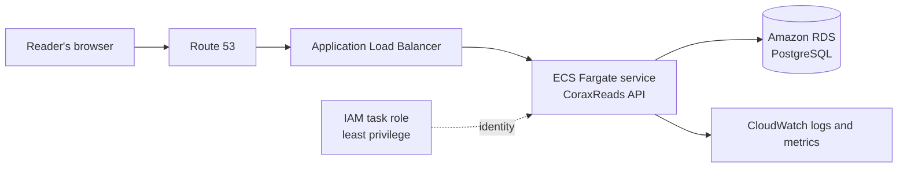
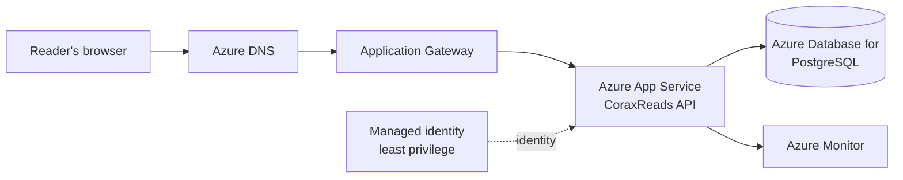
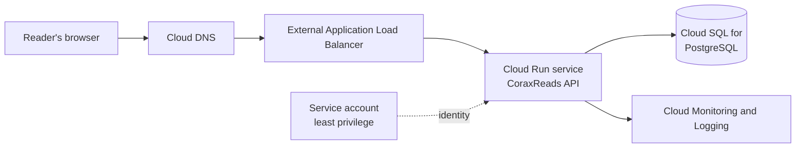

# CoraxReads cloud architecture comparisons

AWS is the course's primary cloud path. These three diagrams show equivalent **conceptual** production-style building blocks so learners can recognize the pattern across providers. They are not deployment instructions, do not create cloud resources, and do not replace the course's smaller Week 9 exercise or instructor approval.

**AWS primary:** Route 53 provides DNS, an Application Load Balancer routes HTTPS traffic, ECS runs the app, RDS stores relational data, and CloudWatch collects operational signals. IAM task roles grant the service only the access it needs. Actual networking, certificates, backups, redundancy, and pricing require a design review.

**Azure comparison:** Azure DNS, Application Gateway, App Service, Azure Database for PostgreSQL, Azure Monitor, and managed identities fill similar roles. Names and capabilities differ; this diagram is a mapping aid, not a claim that the services are identical.

**Google Cloud comparison:** Cloud DNS, an external Application Load Balancer, Cloud Run, Cloud SQL, Cloud Monitoring/Logging, and a service account are analogous building blocks. Verify regional availability, network paths, and current service/pricing details before any real design.

## Safe learning sequence

1. Draw and explain the local browser → Express API → PostgreSQL flow first.
2. Compare the three diagrams and label each service by role, not just by vendor name.
3. Keep the course's Week 6–8 practice local. Week 9 uses AWS only, after the instructor approves the cost limit, account protections, and teardown steps.
4. Do not create Azure or Google Cloud accounts for this comparison exercise.
5. Before any real cloud deployment, add TLS, private database networking, secrets management, least-privilege identity, backups, monitoring, budget alerts, and a tested cleanup plan. Budget alerts are not hard spending caps.
