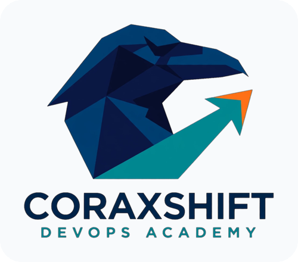

<div align="center">


# Ansible for Beginners

[](GETTING-STARTED.md)
[](course/00-overview.md)
[](#️-how-long-it-takes)
[](GETTING-STARTED.md)

### 👋 Set up many machines the same way, from one place, and repair only the one that goes wrong.

**Coraxshift DevOps Academy** · *Learn. Build. Deploy. Grow.*

[🚀 Get started](GETTING-STARTED.md) · [📖 Course overview](course/00-overview.md) · [🆘 Troubleshooting](course/troubleshooting.md) · [🌐 Website](https://coraxshift-academy.github.io/)

</div>

---

## 🎯 What you will be able to do

| | |
|---|---|
| 📋 **List** | Write an inventory of machines and groups |
| ⚡ **Ask** | Run quick ad-hoc commands on many machines at once |
| 📜 **Describe** | Write a playbook with tasks and modules |
| 🧩 **Customise** | Use variables, templates and handlers |
| 🔁 **Repeat** | Show that running it twice changes nothing |
| 🔍 **Preview** | Use check mode and diff before any change |
| 🩺 **Observe** | Write a health check that spots abnormal machines |
| 🛠️ **Repair** | Fix only the broken machine with `--limit` |
| 💼 **Show off** | Put the full journey in your portfolio |

> [!NOTE]
> No cost and no powerful laptop. You practise in a free Codespace in your browser. You do **not** need to be a programmer, and you only need pretend machines inside your Codespace. Take **Linux**, **Bash** and **Git and GitHub for Beginners** first. Terraform helps but is not required.

## ⏱️ How long it takes

3 classes (2 hours each) + an assignment (2 to 3 hours) + a role play, a quiz and a recap = **about 10 hours in total**. Go at your own pace.

## 🗺️ Course map

| Step | What you do | Time |
|:--|:--|--:|
| 📘 Overview | [Welcome, goals, how the course works](course/00-overview.md) | 10 min |
| 📝 Class 1 | [Inventory and your first playbook](course/class-1-inventory-and-first-playbook.md) | 2 h |
| 🧩 Class 2 | [Variables, templates and handlers](course/class-2-variables-templates-handlers.md) | 2 h |
| 🛡️ Class 3 | [Preview, limit and repair](course/class-3-preview-limit-and-repair.md) | 2 h |
| 🏢 Assignment | [Set up a small office](course/assignment-set-up-a-small-office.md) | 2 to 3 h |
| 🎭 Role play | [Explain Ansible to a business owner](course/role-play-explain-ansible.md) | 15 min |
| 📝 Quiz | [12 questions, 90% earns the badge](course/quiz.md) | 20 min |
| 🏁 Finish | [Recap and what's next](course/recap-and-whats-next.md) | 10 min |
| 🆘 Stuck? | [Troubleshooting](course/troubleshooting.md) | any time |

> [!TIP]
> Work through the steps **in order**. Type the commands yourself instead of only reading them. That is where the learning happens.

## 🛡️ Safety rules

- Read a command before you run it, especially if it deletes or overwrites anything.
- Only run what the lessons tell you to run, and only on your own practice Codespace.
- Never put passwords, tokens or keys inside a file, a commit or a screenshot.
- Keep forwarded ports **Private**.
- Save your own work in **your own repositories**, not in this course repository.

## 📁 What is in this repository

```text
README.md             you are here
GETTING-STARTED.md    open your Codespace and check your tools
assets/               banner and logo
course/               classes, assignment, role play, quiz, troubleshooting
```

<div align="center">



**Coraxshift DevOps Academy** · Learn. Build. Deploy. Grow.

Course material © 2026 Coraxshift DevOps Academy. For enrolled students only.

</div>
