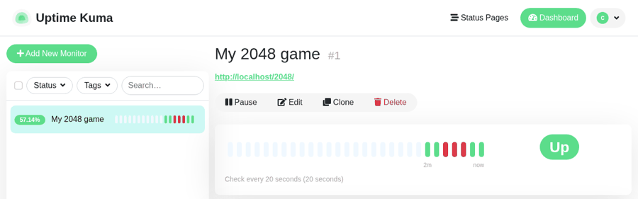
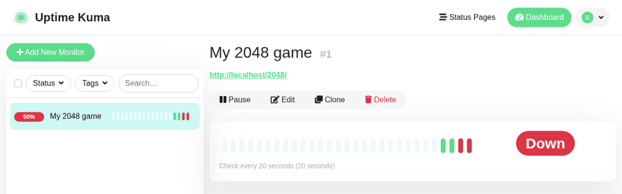

# Assignment B: Operations and Recovery Drill with Uptime Kuma

**Linux for Beginners · Coraxshift DevOps Academy**

- ⏱️ **Time:** 105 minutes
- 📶 **Level:** Beginner to intermediate
- 🖥️ **Where:** the same Codespace you used for Assignment A
- 📁 **Save your report and screenshots in:** your own portfolio repository

## 🎯 The goal

Your 2048 game is live. But a site that loads once isn't the job: engineers keep it running, notice when it breaks and fix it fast. Today you become the **on-call engineer**.

You will install **Uptime Kuma**, a real open-source monitoring tool used by companies and home-labbers worldwide, run it as a background process, put Nginx in front of it, and point it at your 2048 game. Then you will break things on purpose, safely, and recover:

1. **Missing files:** the game disappears. Does Uptime Kuma notice?
2. **Crashed process:** Uptime Kuma itself stops. What does Nginx show?
3. **Broken config:** a typo in an Nginx file. Can you catch it before it does damage?

Think of Uptime Kuma as a **security guard** who walks past the 2048 arcade every 20 seconds and checks the door is open. Nginx is the **receptionist** at the front desk who sends visitors to the guard's office.

```text
Browser --Private port 8080--> Nginx :8080 --proxy--> Uptime Kuma 127.0.0.1:3001
                                                          |
                                                          +-- every 20 s --> http://localhost/2048/ --> Nginx :80 --> /var/www/html/2048/
```

**About the app:** [Uptime Kuma](https://github.com/louislam/uptime-kuma) is created by Louis Lam and contributors and released under the **MIT License**. This course uses version **2.5.12**, the latest stable release when it was tested (20 November 2026).

## 💰 Cost and cleanup

| | |
|---|---|
| **Cost** | $0. Uptime Kuma runs inside your free Codespace. No account or card is needed. |
| **Clean up** | Stop Uptime Kuma when you finish the drill (the assignment shows how), then stop the Codespace. |

## Prerequisites

- [Assignment A](assignment-a-2048-nginx.md) completed: `http://localhost/2048/` returns `HTTP 200`
- **Node.js 20.4 or newer** and npm (Uptime Kuma 2.5.12's requirement). Tested with Node.js 22 and 24.
- About 1 GB of free disk space
- [Class 3](class-3-processes-networking-scripting.md) Step 2 (the `kill` drill) completed

## Why we install it with npm, not Docker

Uptime Kuma can run with Docker or directly with Node.js and npm. We use **npm** here because:

- It works the same in every Codespace, with no Docker setup to troubleshoot.
- Uptime Kuma runs as a normal Linux **process** you can see with `ps`, stop with `kill` and restart, which is exactly what this assignment practises. Inside Docker, the process is hidden behind the container.

You will learn Docker properly later in the DevOps path.

## Safety rules for this drill

- Only do this in **your own** Codespace.
- Keep every forwarded port **Private**.
- Only stop processes **you** started (Uptime Kuma and your practice `sleep`). Never kill anything you don't recognise.
- **Move, don't delete.** The missing-files drill moves the game aside and puts it straight back.
- **Never restart or reload Nginx with a config that failed `nginx -t`.**
- The Uptime Kuma password you create is for this lab only. **Don't reuse a real password**, and never put it in a screenshot or Git.

## Task 1: Check your starting point

**Why this matters:** before you build on something, check the foundations are solid.

**Run it:**

```bash
cd /workspaces/linux-for-beginners
sudo service nginx start
node --version
npm --version
curl -sS -o /dev/null -w 'HTTP %{http_code}\n' http://localhost/2048/
df -h /
```

**What each command does:**

| Command | What it does |
|---|---|
| `sudo service nginx start` | Makes sure Nginx is running |
| `node --version` | Shows the Node.js version. Uptime Kuma is written in JavaScript and runs on Node.js. |
| `npm --version` | Shows the version of npm, Node's package manager (an `apt` for JavaScript libraries) |
| `curl ... /2048/` | Confirms your game from A still works |
| `df -h /` | Checks you have room to install |

**What you should see:**

```text
 * Starting nginx nginx
   ...done.
v24.22.3
11.19.1
HTTP 200
Filesystem      Size  Used Avail Use% Mounted on
-                38G  7.9G   30G  22% /
```

**If yours looks different:**

- Any Node.js version **v20.4.0 or newer** is fine (for example `v22.x` or `v24.x`).
- `node: command not found`, or a version below 20.4: run `nvm --version`. If that prints a number, run `nvm install --lts`, then `node --version` again. If not, ask your instructor. **Don't** run `sudo apt install nodejs`: Ubuntu 24.04's package is Node.js 18, which is too old.
- `HTTP 404` for 2048: finish [Assignment A](assignment-a-2048-nginx.md) first.

## Task 2: Install Uptime Kuma

**Why this matters:** installing an app from its source is an everyday engineering job. We pin an exact version (`2.5.12`) so every student gets the same, tested result, like following a specific edition of a recipe book.

**Run it:**

```bash
cd ~/apps
git clone --depth 1 --branch 2.5.12 https://github.com/louislam/uptime-kuma.git
cd ~/apps/uptime-kuma
head -n 3 LICENSE
npm run setup
```

**What each command does:**

| Command | What it does |
|---|---|
| `git clone --depth 1 --branch 2.5.12 <url>` | Downloads only version 2.5.12 (`--branch`), without the full history (`--depth 1`), so it's quicker |
| `head -n 3 LICENSE` | Confirms the license |
| `npm run setup` | Runs Uptime Kuma's official setup script: installs the JavaScript libraries it needs (`npm ci --omit dev`), then downloads the ready-made web interface (`download-dist`) |

**What you should see** (trimmed; it takes about 1–3 minutes):

```text
Cloning into 'uptime-kuma'...
Note: switching to '5aa5dec425f8a955b54e150636979a6927745ec5'.
...
MIT License

Copyright (c) 2021 Louis Lam

> uptime-kuma@2.5.12 setup
> git checkout 2.5.12 && npm ci --omit dev --no-audit && npm run download-dist
...
npm warn deprecated rimraf@3.0.2: Rimraf versions prior to v4 are no longer supported
...
added 650 packages in 14s
...
> uptime-kuma@2.5.12 download-dist
> node extra/download-dist.js

Downloading dist
...
Extracting dist...
Done
```

**If yours looks different:**

- **`npm warn deprecated ...` lines are normal.** They are notes for the app's developers, not errors. Don't try to fix them.
- `You are in 'detached HEAD' state` is normal: you downloaded a fixed version, not a branch.
- `npm notice New major version of npm available` is just a notice. Don't upgrade npm for this course.
- `npm warn EBADENGINE` or `Unsupported engine`: your Node.js is too old. See Task 1, then run `npm run setup` again.
- `fatal: destination path 'uptime-kuma' already exists`: you've cloned it before. Run `cd ~/apps/uptime-kuma && npm run setup`.
- The download stops with a network error: run `npm run setup` again.

## Task 3: Start Uptime Kuma as a background process

**Why this matters:** servers run programs in the **background** for days or months. You need to know how to start one, find it, check its port and read its log. Today you do all four.

**Run it:**

```bash
cd ~/apps/uptime-kuma
nohup node server/server.js --host=127.0.0.1 > ~/uptime-kuma.log 2>&1 &
cd /workspaces/linux-for-beginners
```

Wait about 10 seconds, then check on it:

```bash
pgrep -a uptime-kuma
sudo ss -ltnp | grep 3001
tail -n 5 ~/uptime-kuma.log
curl -sI http://localhost:3001 | head -n 4
```

**What each command does:**

| Command or part | What it does |
|---|---|
| `node server/server.js` | Starts Uptime Kuma with Node.js |
| `--host=127.0.0.1` | Listens **only on the inside** (`127.0.0.1` means *this computer*). Visitors must come through Nginx, the front door. |
| `> ~/uptime-kuma.log 2>&1` | Sends all output (normal messages and errors, `2>&1`) into a log file in your home folder |
| `nohup ... &` | `&` runs it in the background; `nohup` keeps it running even if you close the terminal |
| `pgrep -a uptime-kuma` | Finds the process. Uptime Kuma renames its process to `uptime-kuma`, which makes it easy to spot. |
| `sudo ss -ltnp \| grep 3001` | Shows what is listening on port 3001, Uptime Kuma's default port |
| `tail -n 5 ~/uptime-kuma.log` | Shows the last 5 lines of its log |
| `curl -sI http://localhost:3001` | Asks Uptime Kuma for its headers |

**What you should see** (trimmed):

```text
[1] 9133
9133 uptime-kuma
LISTEN 0      511        127.0.0.1:3001       0.0.0.0:*    users:(("uptime-kuma",pid=9133,fd=21))
... [SETUP-DATABASE] INFO: Listening on:
... [SETUP-DATABASE] INFO: -  http://127.0.0.1:3001
... [SETUP-DATABASE] INFO: Waiting for user action...
HTTP/1.1 302 Found
X-Powered-By: Express
Connection: close
Location: /setup-database
```

`127.0.0.1:3001` proves it only listens on the inside. `302 Found` with `Location: /setup-database` means *"I'm alive, please finish my first-time setup"*. That's a healthy answer.

**If yours looks different:**

- `pgrep` prints nothing: it crashed on start. Read the log with `tail -n 30 ~/uptime-kuma.log`. The most common reasons are a Node.js version that's too old, or Task 2 not finishing.
- `EADDRINUSE` in the log: something is already using port 3001, probably an earlier Uptime Kuma. Check with `pgrep -a uptime-kuma` and stop only that one with `kill <PID>`.
- `curl: (7) Failed to connect`: wait another 10 seconds and try again. It takes a moment to start.
- The first line of the log says `nohup: ignoring input`. That's normal.
- Codespaces may pop up a notice that port 3001 is available. You can ignore it; you'll use Nginx on port 8080 instead. If you do open it, keep it Private.

## Task 4: Put Nginx in front as a reverse proxy

**Why this matters:** in the real world, apps rarely face visitors directly. A **reverse proxy** (Nginx here) receives every visitor and forwards them to the right app, like a receptionist putting calls through to the right desk. It gives you one front door to log, secure and control.

Uptime Kuma works best at the root of its own address, not in a sub-folder like `/status/`, so we give it its own port: **8080**.

**Run it.** First create the site file (copy the whole block, from `sudo tee` down to the final `EOF`):

```bash
sudo tee /etc/nginx/sites-available/uptime-kuma > /dev/null <<'EOF'
# Uptime Kuma behind Nginx (Coraxshift Linux course, Assignment B)
server {
    listen 8080;
    listen [::]:8080;
    server_name _;

    location / {
        proxy_pass http://127.0.0.1:3001;
        proxy_http_version 1.1;
        proxy_set_header Upgrade $http_upgrade;
        proxy_set_header Connection "upgrade";
        proxy_set_header Host $host;
        proxy_set_header X-Forwarded-For $proxy_add_x_forwarded_for;
        proxy_set_header X-Forwarded-Proto $scheme;
    }
}
EOF
```

Then switch it on, test, and apply:

```bash
cat /etc/nginx/sites-available/uptime-kuma
sudo ln -s /etc/nginx/sites-available/uptime-kuma /etc/nginx/sites-enabled/uptime-kuma
ls -l /etc/nginx/sites-enabled/
sudo nginx -t
sudo service nginx reload
sudo ss -ltnp | grep -E ':(80|3001|8080) '
curl -sI http://localhost:8080 | head -n 1
```

**What each command or setting does:**

| Command or setting | What it does |
|---|---|
| `sudo tee <file> <<'EOF' ... EOF` | Writes everything between the two `EOF` markers into the file, with admin rights |
| `listen 8080;` | This site answers on port 8080 (`[::]:8080` is the same for IPv6) |
| `proxy_pass http://127.0.0.1:3001;` | Forwards every request to Uptime Kuma |
| `Upgrade` / `Connection "upgrade"` | Allows **WebSockets**, the live connection Uptime Kuma's dashboard uses to update in real time. Without these, the dashboard can't connect. |
| `Host`, `X-Forwarded-For`, `X-Forwarded-Proto` | Pass along the visitor's original address and details, so Uptime Kuma knows who is really visiting |
| `sites-available/` vs `sites-enabled/` | *Available* is the menu of site files; *enabled* is what Nginx actually uses. `ln -s` makes a shortcut (symbolic link) from one to the other. |
| `sudo nginx -t` | Tests **all** Nginx config files before you apply them |
| `sudo service nginx reload` | Applies the new config **without dropping visitors** (gentler than `restart`) |

**What you should see** (trimmed):

```text
lrwxrwxrwx 1 root root 34 Nov 19 23:16 default -> /etc/nginx/sites-available/default
lrwxrwxrwx 1 root root 38 Nov 19 23:19 uptime-kuma -> /etc/nginx/sites-available/uptime-kuma
nginx: the configuration file /etc/nginx/nginx.conf syntax is ok
nginx: configuration file /etc/nginx/nginx.conf test is successful
 * Reloading nginx configuration nginx
   ...done.
LISTEN 0      511        127.0.0.1:3001       0.0.0.0:*    users:(("uptime-kuma",pid=9133,fd=21))
LISTEN 0      511          0.0.0.0:8080       0.0.0.0:*    users:(("nginx",pid=9264,fd=9),("nginx",pid=9263,fd=9),("nginx",pid=8494,fd=9))
LISTEN 0      511          0.0.0.0:80         0.0.0.0:*    users:(("nginx",pid=9264,fd=5),("nginx",pid=9263,fd=5),("nginx",pid=8494,fd=5))
...
HTTP/1.1 302 Found
```

You now have three doors: **80** (Nginx: 2048), **8080** (Nginx: front door to Uptime Kuma) and **3001** (Uptime Kuma, inside only).

**If yours looks different:**

- `ln: failed to create symbolic link ... File exists`: you already enabled it. That's fine.
- `nginx -t` fails: read the file and line number in the message, fix that line with `sudo nano /etc/nginx/sites-available/uptime-kuma`, and test again. **Don't reload until the test passes.** A common cause is the copy missing the first or last line.
- `502 Bad Gateway` from port 8080: Nginx works but Uptime Kuma isn't running. Go back to Task 3.
- Port 8080 is missing from `ss`: you skipped `reload`, or the test failed.

## Task 5: First-time setup and monitor your 2048 game

**Why this matters:** monitoring means you hear about a problem before your users tell you.

1. In the **Ports** tab, forward port **8080** (click **Forward a Port**, type `8080`). Set its visibility to **Private**.
2. Open the forwarded address (🌐 icon).
3. **Which database?** Choose **SQLite**, then **Next**. (SQLite keeps everything in one file; perfect for a lab.) Wait a few seconds while it prepares.
4. **Create your admin account.** Pick a username and a **lab-only** password, then **Create**.
5. Click **➕ Add New Monitor** and fill in:
   - **Monitor Type:** `HTTP(s)`
   - **Friendly Name:** `My 2048 game`
   - **URL:** `http://localhost/2048/`
   - **Heartbeat Interval:** `20` (seconds)
6. Click **Save**.

`localhost` works here because Uptime Kuma runs on the same machine as Nginx: it checks the game from the inside, just like your `curl` commands.

**What you should see:** after a few seconds the monitor turns green and says **Up**, with a `200 - OK` message.



*(Real screenshot from our test lab.)*

**If yours looks different:**

- The page keeps spinning or says it can't connect: the WebSocket lines are missing from the Nginx file. Compare it with Task 4, run `sudo nginx -t`, then `sudo service nginx reload`.
- The monitor is red with `404`: check the URL ends with `/2048/` and `curl -I http://localhost/2048/` works.
- You closed the tab before creating the account: just open the address again. Setup continues where you left off.
- Forgot your lab password? Ask your instructor; for a lab you can also stop Uptime Kuma, move `~/apps/uptime-kuma/data` aside and start fresh.

## Task 6: Read the logs

**Why this matters:** logs are your server's diary. When something goes wrong, the answer is usually written there. Reading logs calmly is the most important on-call skill.

**Run it:**

```bash
curl -sS -o /dev/null -w 'HTTP %{http_code}\n' http://localhost/2048/
sudo tail -n 5 /var/log/nginx/access.log
sudo grep "Uptime-Kuma" /var/log/nginx/access.log | tail -n 3
sudo tail -n 5 /var/log/nginx/error.log
tail -n 5 ~/uptime-kuma.log
```

**What each command does:**

| Command | What it does |
|---|---|
| `curl ...` | Makes a fresh request so there is something new in the log |
| `tail -n 5 access.log` | Last 5 visits Nginx recorded: who, when, which page, which status code |
| `grep "Uptime-Kuma" ...` | Picks out only Uptime Kuma's health checks |
| `tail -n 5 error.log` | Last 5 problems Nginx recorded (often empty, and that's good) |
| `tail -n 5 ~/uptime-kuma.log` | Last 5 lines of Uptime Kuma's own log |

**What you should see** (trimmed):

```text
HTTP 200
127.0.0.1 - - [19/Nov/2026:23:21:14 +0000] "GET /2048/ HTTP/1.1" 200 3988 "-" "Uptime-Kuma/2.5.12"
...
... [AUTH] INFO: Successfully logged in user corax-admin. IP=127.0.0.1
... [MONITOR] INFO: Added Monitor: 1 User ID: 1
```

**How to read an access log line:**

```text
127.0.0.1 - - [19/Nov/2026:23:21:14 +0000] "GET /2048/ HTTP/1.1" 200 3988 "-" "Uptime-Kuma/2.5.12"
   |              |                          |                  |    |          |
 who visited    when                    what they asked for   status size   which program
```

**If yours looks different:**

- No `Uptime-Kuma` lines: the monitor isn't saved or is paused. Check the dashboard.
- `error.log` is empty: great. It means no errors were recorded *during this period*, not that nothing can ever go wrong.
- `journalctl -u nginx` won't help here: Codespaces don't run systemd, so Nginx writes to its own files in `/var/log/nginx/`.

## Task 7: Check capacity

**Why this matters:** apps slowly fill disks and use memory. Catching it early is the difference between a calm fix and a 3 a.m. outage.

**Run it:**

```bash
uptime
free -h
df -h /
ps -o pid,user,%cpu,%mem,etime,cmd -C uptime-kuma
du -sh ~/apps/uptime-kuma/data ~/apps/uptime-kuma/node_modules ~/apps/2048
sudo du -sh /var/log/nginx
```

**What each command does:**

| Command | What it does |
|---|---|
| `uptime`, `free -h`, `df -h /` | Load, memory and disk (from Class 1) |
| `ps -o ... -C uptime-kuma` | Shows Uptime Kuma's CPU and memory use and how long it has run (`ELAPSED`) |
| `du -sh <folders>` | How much disk each folder uses: Uptime Kuma's data, its libraries, and the 2048 game |
| `sudo du -sh /var/log/nginx` | How much space Nginx's logs use |

**What you should see** (trimmed):

```text
    PID USER     %CPU %MEM     ELAPSED CMD
   9133 codespa+  3.3 12.0       01:30 uptime-kuma
1.3M    /home/codespace/apps/uptime-kuma/data
240M    /home/codespace/apps/uptime-kuma/node_modules
1.5M    /home/codespace/apps/2048
28K     /var/log/nginx
```

Notice the difference: **the game is 1.5 MB, but Uptime Kuma's libraries are 240 MB.** A tool's *dependencies* often outweigh the app itself.

**If yours looks different:** your numbers will differ (a Codespace has more memory than our test lab, so `%MEM` will be lower). Write down which reading would worry you first on a real server, and why.

## Task 8: Drill 1: the game goes missing 🔧

**Why this matters:** a bad deployment or an accidental move can make files vanish. You'll cause it on purpose, watch your monitoring catch it, and restore it.

First, safety checks:

```bash
test -d /var/www/html/2048 && echo "Deployed site exists"
test ! -e /var/www/html/2048.offline && echo "Recovery name is available"
```

You must see **both** lines. If either is missing, stop and ask for help.

**Break it** (move the folder aside; never delete it):

```bash
sudo mv /var/www/html/2048 /var/www/html/2048.offline
curl -sS -o /dev/null -w 'HTTP %{http_code}\n' http://localhost/2048/
```

Now **watch the Uptime Kuma dashboard** for up to a minute. 👀

**What you should see:**

```text
Deployed site exists
Recovery name is available
HTTP 404
```

Within about 20–40 seconds, the monitor turns red and says **Down**:



Look at the evidence in the logs too:

```bash
sudo grep "GET /2048/ " /var/log/nginx/access.log | tail -n 3
grep "Failing" ~/uptime-kuma.log | tail -n 1
```

```text
127.0.0.1 - - [19/Nov/2026:23:21:34 +0000] "GET /2048/ HTTP/1.1" 404 162 "-" "Uptime-Kuma/2.5.12"
127.0.0.1 - - [19/Nov/2026:23:21:54 +0000] "GET /2048/ HTTP/1.1" 404 162 "-" "Uptime-Kuma/2.5.12"
127.0.0.1 - - [19/Nov/2026:23:22:14 +0000] "GET /2048/ HTTP/1.1" 404 162 "-" "Uptime-Kuma/2.5.12"
... [MONITOR] WARN: Monitor #1 'My 2048 game': Failing: Request failed with status code 404 | Interval: 20 seconds | Type: http | Down Count: 0 | Resend Interval: 0
```

**Fix it** straight away:

```bash
sudo mv /var/www/html/2048.offline /var/www/html/2048
curl -sS -o /dev/null -w 'HTTP %{http_code}\n' http://localhost/2048/
```

```text
HTTP 200
```

Within about 20 seconds the monitor turns green again. 🎉

**What each command does:** `test -d` checks a folder exists; `test ! -e` checks a name is *not* taken; `mv` moves the folder aside and back; `curl` confirms the status each time.

**If yours looks different:**

- The monitor stays green: wait for the next check (up to 20 seconds) and refresh the page.
- `mv: cannot stat '/var/www/html/2048.offline'` when restoring: the first `mv` didn't happen. Check with `ls /var/www/html`.
- Still `404` after restoring: run `ls -lah /var/www/html/2048/` and compare with Assignment A, Task 3.

## Task 9: Drill 2: the monitoring app crashes 🔧

**Why this matters:** processes crash. Knowing how a reverse proxy behaves when its app is gone (and how to bring the app back) is core on-call knowledge. This is also your `kill` practice on a real app.

**Find it, then stop it:**

```bash
pgrep -a uptime-kuma
```

Use the PID from **your** output in place of `9133`:

```bash
kill 9133
```

Wait about 5 seconds (it shuts down politely), then check:

```bash
pgrep -a uptime-kuma || echo "Uptime Kuma is not running"
tail -n 4 ~/uptime-kuma.log
curl -sS -o /dev/null -w 'HTTP %{http_code}\n' http://localhost:8080/
sudo tail -n 1 /var/log/nginx/error.log
```

**What you should see:**

```text
9133 uptime-kuma
Uptime Kuma is not running
... [DB] INFO: Closing the database
... [DB] INFO: Database closed
... [CLOUDFLARED] INFO: Stop cloudflared
... [SERVER] INFO: Graceful shutdown successful!
HTTP 502
2026/11/19 23:22:53 [error] 9264#9264: *144 connect() failed (111: Connection refused) while connecting to upstream, client: ::1, server: _, request: "GET / HTTP/1.1", upstream: "http://127.0.0.1:3001/", host: "localhost:8080"
```

**`502 Bad Gateway`** means *"I (Nginx) am fine, but the app behind me isn't answering."* The error log says exactly that: `Connection refused ... upstream: "http://127.0.0.1:3001/"`. If you refresh the dashboard tab now, you'll see a `502 Bad Gateway` page.

**Fix it:** start it again, the same way as Task 3:

```bash
cd ~/apps/uptime-kuma
nohup node server/server.js --host=127.0.0.1 > ~/uptime-kuma.log 2>&1 &
cd /workspaces/linux-for-beginners
```

Wait about 10 seconds, then verify:

```bash
pgrep -a uptime-kuma
curl -sS -o /dev/null -w 'HTTP %{http_code}\n' http://localhost:8080/
grep "Listening on" ~/uptime-kuma.log
```

```text
10052 uptime-kuma
HTTP 302
... [SERVER] INFO: Listening on:  http://127.0.0.1:3001
```

Refresh the dashboard and log in again: **your 2048 monitor is still there**, with the outage from Drill 1 recorded in its history. The data survived because it lives on disk in `~/apps/uptime-kuma/data`, not in the process's memory.

**What each command does:** `pgrep -a` finds the PID; `kill <PID>` asks it to stop (SIGTERM); `|| echo` prints a friendly message if `pgrep` finds nothing; `curl` shows what visitors would get; the error log explains why.

**If yours looks different:**

- `pgrep` still shows the process after 5 seconds: it's still shutting down. Wait a few more seconds and check again. Only if it is still there after a minute, use `kill -9 <PID>` (forceful, last resort).
- After restarting you see `302` but the browser shows the database setup again: the first setup didn't finish. Repeat Task 5.
- `HTTP 502` after restarting: give it 10 more seconds, then check `tail -n 20 ~/uptime-kuma.log`.

## Task 10: Drill 3: catch a broken config before it bites 🔧

**Why this matters:** a single missing `;` in an Nginx file can take every site on a server offline, *if* you apply it. `nginx -t` is your safety net. You'll practise on a **temporary test file**, so the real Nginx is never at risk.

First check the temporary names are free:

```bash
if [ -e /tmp/nginx-lab.conf ] || [ -e /tmp/nginx-lab.conf.backup ]; then
  echo "Stop: a previous lab file exists; ask for help before continuing."
else
  echo "Temporary lab paths are clear."
fi
```

Continue only if it says the paths are clear. Create a small test config and a backup copy, then test it:

```bash
sudo tee /tmp/nginx-lab.conf >/dev/null <<'EOF'
events {}
http {
  server {
    listen 8081;
    location / { return 200 "Lab OK\n"; }
  }
}
EOF
sudo cp -a /tmp/nginx-lab.conf /tmp/nginx-lab.conf.backup
sudo nginx -t -c /tmp/nginx-lab.conf
```

**Break it:** open the temporary file and delete the `;` after `listen 8081`:

```bash
sudo nano /tmp/nginx-lab.conf
```

Save (**Ctrl + O**, **Enter**, **Ctrl + X**) and test again:

```bash
sudo nginx -t -c /tmp/nginx-lab.conf
```

**Fix it:** restore the backup and test once more, then confirm the real sites were never affected:

```bash
sudo cp -a /tmp/nginx-lab.conf.backup /tmp/nginx-lab.conf
sudo nginx -t -c /tmp/nginx-lab.conf
sudo service nginx status
curl -sS -o /dev/null -w 'HTTP %{http_code}\n' http://localhost/2048/
sudo rm /tmp/nginx-lab.conf /tmp/nginx-lab.conf.backup
```

**What each command does:** `nginx -t -c <file>` tests only the named file (`-c`) instead of the live config. `cp -a` copies while keeping permissions and timestamps. The last line tidies up the two temporary files you created.

**What you should see:**

```text
Temporary lab paths are clear.
nginx: the configuration file /tmp/nginx-lab.conf syntax is ok
nginx: configuration file /tmp/nginx-lab.conf test is successful
```

After breaking it:

```text
2026/11/19 23:23:33 [emerg] 10213#10213: directive "listen" is not terminated by ";" in /tmp/nginx-lab.conf:5
nginx: configuration file /tmp/nginx-lab.conf test failed
```

After fixing it:

```text
nginx: the configuration file /tmp/nginx-lab.conf syntax is ok
nginx: configuration file /tmp/nginx-lab.conf test is successful
 * nginx is running
HTTP 200
```

💡 The error points at **line 5**, but you removed the `;` on line 4. Nginx only noticed something was wrong when it reached the next line. When an error line looks fine, **check the line above it**.

**If yours looks different:** if the second test still passes, the `;` wasn't removed or the file wasn't saved. Open it again and check.

### ⭐ Bonus: the same mistake in a real site file (test only)

Want to see why testing matters on a live file? This is still safe, because you'll **only test**, never reload:

```bash
cp /etc/nginx/sites-available/uptime-kuma ~/uptime-kuma.nginx.backup
sudo nano /etc/nginx/sites-available/uptime-kuma
```

Delete the `;` at the end of the `proxy_pass` line, save, then:

```bash
sudo nginx -t
curl -sS -o /dev/null -w 'HTTP %{http_code}\n' http://localhost:8080/
sudo cp ~/uptime-kuma.nginx.backup /etc/nginx/sites-available/uptime-kuma
sudo nginx -t
```

```text
2026/11/19 23:23:43 [emerg] 10271#10271: invalid number of arguments in "proxy_pass" directive in /etc/nginx/sites-enabled/uptime-kuma:9
nginx: configuration file /etc/nginx/nginx.conf test failed
HTTP 302
nginx: the configuration file /etc/nginx/nginx.conf syntax is ok
nginx: configuration file /etc/nginx/nginx.conf test is successful
```

Uptime Kuma kept answering (`302`) even though the file on disk was broken, because Nginx was still running the last **good** config. Nothing changes until you reload. That's why the rule is: **test, then reload, never the other way round.**

## Task 11 (optional): Stop Uptime Kuma when you're finished

Uptime Kuma uses memory while it runs. When you've submitted your work, you can stop it:

```bash
kill $(pgrep uptime-kuma)
```

`$(pgrep uptime-kuma)` puts the PID in for you. It's safe here because you know exactly which process that name matches. To start it again later, use the commands in Task 3. Your monitors and history are kept.

## Security and reliability notes

Add a short section to your report explaining, in your own words:

- Why Uptime Kuma listens on `127.0.0.1` and visitors go through Nginx instead
- Why passwords, tokens and keys must never appear in screenshots or Git
- Why a production server should only open the ports its services need
- Why, on a real server, you'd make Uptime Kuma start automatically after a reboot (with a service manager such as systemd or PM2), while in a Codespace you start it by hand
- Why teams switch off resources they no longer need (this lab creates no cloud resources)

## 📤 Submit

In your portfolio repository, include (with private details removed):

1. `pgrep`, `ss` and log output from Task 3 showing Uptime Kuma running on `127.0.0.1:3001`
2. Your `nginx -t` success and the `ss` output showing ports 80, 8080 and 3001 (Task 4)
3. A screenshot of your **My 2048 game** monitor showing **Up** (Task 5)
4. One access log line from Uptime Kuma, with each part explained in your own words (Task 6)
5. Your capacity snapshot and which reading you'd watch first (Task 7)
6. Drill 1: the `404`, a **Down** screenshot, and the `200` after restoring
7. Drill 2: the `502`, the error log line, and the restart proving your monitor survived
8. Drill 3: the failed test and the passing test after restoring
9. Your security and reliability notes

## ✅ Recap

- You installed a real open-source app from source with a pinned version.
- You ran it as a **background process**, found it with `pgrep`, checked its port with `ss` and read its log.
- You put **Nginx in front as a reverse proxy**, including WebSocket support.
- You used monitoring to **detect** an outage, logs to **explain** it, and safe steps to **recover**.
- `404` = the file isn't there. `502` = the app behind Nginx isn't answering. `nginx -t` before every reload.

Next: [Assignment C: Your portfolio page](assignment-c-static-portfolio.md). Time to show off what you've built. ✨

---

<table width="100%"><tr><td align="left">[⬅️ Assignment A](assignment-a-2048-nginx.md)</td><td align="center"><a href="troubleshooting.md">🆘 Stuck?</a></td><td align="right">[Assignment C ➡️](assignment-c-static-portfolio.md)</td></tr></table>
