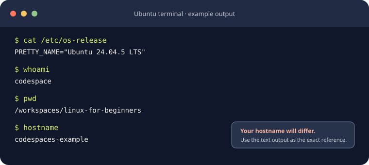

# Class 1: Meet Linux, Check Your System, Find Your Way Around

**Linux for Beginners · Coraxshift DevOps Academy** · ⏱️ 2 hours

## 👋 Welcome to your first class

Today you will open a real Linux computer in your browser, ask it who and where you are, check its health, and create your first files. By the end of this class the terminal will feel less like a mystery and more like a conversation.

> 📖 **From my café:** In 2007 I opened a cybercafe with 12 or more computers. Every morning I walked the floor and checked each machine by hand: is it on, is it slow, is the disk full? Today's class is the same walk, done with typed commands on one Linux computer.

**By the end of this class you can:**

- Open your Codespace terminal and recognise the prompt
- Check your Linux version, username, folder and computer name
- Check memory, disk and uptime
- Move between folders and create, copy, move and delete files
- Explain the main Linux folders (`/`, `/home`, `/etc`, `/var`, `/tmp`)

## 💰 Cost and cleanup

| | |
|---|---|
| **Cost** | $0. Everything today runs inside your free Codespace. |
| **If forgotten** | A running Codespace uses your free monthly hours. It stops itself after a period of no use, but stop it yourself when you finish |
| **Clean up** | Close the terminal, then in GitHub open **Codespaces** and choose **Stop codespace**. Your files in `practice/` stay for next time |

## Prerequisites

- A GitHub account with access to this course repository
- A Codespace opened on this repository (see [Getting Started](../GETTING-STARTED.md))
- Nothing else. No Linux experience needed.

## How every step works

Each step follows the same five parts, so you always know what is coming:

1. **Why this matters**: one sentence and an everyday comparison
2. **Run it**: commands to copy into the terminal (use the copy button on each box)
3. **What each command does**
4. **What you should see**: real output from our test lab, trimmed
5. **If yours looks different**: the most likely reason and the fix

> 💡 **Your output will never match ours character for character.** Times, sizes, names and numbers change from computer to computer. Compare the *meaning*, not every letter.

## Step 0: Open your terminal and go "home base"

**Why this matters:** every class starts from the same folder, so the commands work the same for everyone. Think of it as the classroom door: we all walk in through it.

In your Codespace, open the terminal (menu **☰ → Terminal → New Terminal**, or press **Ctrl + `**). You will see a **prompt**, the line waiting for you to type. It looks something like this:

```text
@your-github-name ➜ /workspaces/linux-for-beginners (main) $
```

**Run it:**

```bash
cd /workspaces/linux-for-beginners
```

**What it does:** `cd` means *change directory*. It moves you into the course folder. Directory is just another word for folder.

**What you should see:** nothing at all. In Linux, **no message usually means success**.

**If yours looks different:** `No such file or directory` means your Codespace was opened on a different repository. Close it and open a Codespace from the **linux-for-beginners** repository.

## Step 1: Ask Linux who and where you are

**Why this matters:** before you change anything on a server, you check which machine you are on and who you are logged in as. It's like checking the house number before you put your key in the door.

**Run it:**

```bash
cat /etc/os-release
whoami
pwd
hostname
```

**What each command does:**

| Command | What it does |
|---|---|
| `cat /etc/os-release` | Prints the file that describes your Linux version. `cat` shows a file's contents. |
| `whoami` | Prints your username |
| `pwd` | Prints your current folder (*print working directory*) |
| `hostname` | Prints the computer's name |

**What you should see** (trimmed):

```text
PRETTY_NAME="Ubuntu 24.04.5 LTS"
NAME="Ubuntu"
VERSION_ID="24.04"
...
codespace
/workspaces/linux-for-beginners
codespaces-xxxxxx
```



**If yours looks different:**

- A different Ubuntu patch number (for example `24.04.3`) or a different Ubuntu version is fine. Tell your instructor if it does not say Ubuntu at all.
- Your hostname will be your own Codespace's name. That's expected.
- If `pwd` shows a different folder, run Step 0 again.

## Step 2: Check your server's health

**Why this matters:** memory and disk are a server's fuel and storage. If the disk fills up to 100%, logs stop being written and apps start failing. It's like checking the fuel gauge before a long drive.

**Run it:**

```bash
uptime
free -h
df -h /
```

**What each command does:**

| Command | What it does |
|---|---|
| `uptime` | How long the computer has been on, and its *load average* (how busy it has been over the last 1, 5 and 15 minutes) |
| `free -h` | Memory (RAM) in use and available. `-h` means *human-readable* (MB and GB instead of bytes). |
| `df -h /` | Disk space on the main drive. `/` means *the main drive*. |

**What you should see:**

```text
 23:16:19 up  1:02,  0 user,  load average: 0.07, 0.02, 0.00
               total        used        free      shared  buff/cache   available
Mem:           1.9Gi       261Mi       371Mi       1.1Mi       1.5Gi       1.7Gi
Swap:             0B          0B          0B
Filesystem      Size  Used Avail Use% Mounted on
-                38G  7.8G   30G  22% /
```

The most useful column in `free -h` is **available**: memory programs can still use. The most useful column in `df -h /` is **Use%**.

**If yours looks different:**

- Your numbers will be different (a Codespace often has 8 GB of memory or more). That's fine.
- `Swap: 0B` is normal in a Codespace.
- The `Filesystem` name differs between computers (`overlay`, `/dev/root`, `-` and others are all fine).
- If `Use%` is above 90%, tell your instructor before installing anything.

## Step 3: Move around and make folders

**Why this matters:** on a server you are always moving between folders: logs in one place, settings in another. `ls`, `cd` and `pwd` are your eyes, legs and map.

**Run it** one line at a time:

```bash
ls
ls -la
mkdir -p practice/lab
cd practice/lab
pwd
cd ../..
pwd
```

**What each command does:**

| Command | What it does |
|---|---|
| `ls` | Lists what is in the current folder |
| `ls -la` | Lists **a**ll files, including hidden ones that start with `.`, in **l**ong format (permissions, owner, size, date) |
| `mkdir -p practice/lab` | Makes a folder. `-p` also creates the parent folder (`practice`) if it doesn't exist, and doesn't complain if it already does. |
| `cd practice/lab` | Moves into the new folder |
| `cd ../..` | Moves up two levels. `..` always means *the folder above me*. |

**What you should see** (trimmed):

```text
GETTING-STARTED.md  README.md  modules
total 16
drwxr-xr-x 4 codespace codespace  128 Nov 19 23:15 .
drwxr-xr-x 3 root      root        60 Nov 19 23:15 ..
-rw-r--r-- 1 codespace codespace 9452 Nov 19 23:15 GETTING-STARTED.md
-rw-r--r-- 1 codespace codespace 2062 Nov 19 23:15 README.md
...
/workspaces/linux-for-beginners/practice/lab
/workspaces/linux-for-beginners
```

**If yours looks different:**

- You may see extra hidden entries like `.git` or `.github`. Those are normal.
- `cd: practice/lab: No such file or directory` means `mkdir` didn't run or you were in another folder. Run Step 0, then this step again.
- Lost? `cd /workspaces/linux-for-beginners` always brings you back.

## Step 4: Tour the Linux file system

**Why this matters:** every Linux server uses the same layout. Once you know it, you can find settings and logs on any server in the world, like knowing every supermarket keeps milk at the back.

**Run it:**

```bash
ls /
ls /home
ls /var
```

**What each command does:** each `ls` lists one important folder. A path starting with `/` is an *absolute path*: it starts from the very top.

**What you should see** (trimmed):

```text
bin                boot  etc   lib    media  opt   root  sbin                srv  tmp  var
bin.usr-is-merged  dev   home  lib64  mnt    proc  run   sbin.usr-is-merged  sys  usr  workspaces
codespace
backups  cache  lib  local  lock  log  mail  opt  run  spool  tmp
```

**The folders that matter most:**

| Folder | What lives there | Analogy |
|---|---|---|
| `/` | The root: the top of everything | The front door of the building |
| `/home` | Users' personal folders (yours is `/home/codespace`) | Each person's bedroom |
| `/etc` | Settings (configuration) files, for example Nginx's settings in `/etc/nginx` | The building's rule book |
| `/var` | Things that change: logs in `/var/log`, websites in `/var/www` | The post room and noticeboard |
| `/tmp` | Temporary files that may be cleared | A scratch pad |

**If yours looks different:**

- A slightly different list is fine. Codespaces add their own folders.
- There is no `/var/www` yet. It appears in Class 2 when you install the Nginx web server.

## Step 5: Create, read, copy, move and delete a file

**Why this matters:** these five actions are the bread and butter of every server task, from editing a config to rotating a log.

**Run it:**

```bash
echo "Hello Coraxshift" > practice/lab/hello.txt
cat practice/lab/hello.txt
cp practice/lab/hello.txt practice/lab/hello-copy.txt
mv practice/lab/hello-copy.txt practice/lab/hello-moved.txt
ls practice/lab/
rm practice/lab/hello-moved.txt
ls practice/lab/
```

**What each command does:**

| Command | What it does |
|---|---|
| `echo "..." > file` | Writes text into a file. `>` means *send into this file* and replaces what was there. |
| `cat file` | Shows the file's contents |
| `cp a b` | Copies `a` to `b` |
| `mv a b` | Moves or renames `a` to `b` |
| `rm file` | Deletes the file. **There is no recycle bin in Linux.** |

**What you should see:**

```text
Hello Coraxshift
hello-moved.txt  hello.txt
hello.txt
```

**If yours looks different:**

- `No such file or directory`: you are probably not in the course folder. Run Step 0.
- Be careful with `rm`. Always read the file name twice before pressing Enter. In this course we prefer **moving** files aside over deleting them.

## ✅ Recap

- The **terminal** is a conversation: you type a command, Linux answers. No answer usually means success.
- `whoami`, `pwd`, `hostname` and `cat /etc/os-release` tell you who and where you are.
- `uptime`, `free -h` and `df -h /` are your server's health gauges.
- `ls`, `cd`, `mkdir`, `cp`, `mv`, `rm` and `cat` are your everyday tools.
- `/etc` holds settings, `/var/log` holds logs, `/home` holds users.

## 📤 Push to your portfolio

In your own portfolio repository (not this course repo), write a short note:

1. What is Linux, in one sentence of your own?
2. Which Ubuntu version is your Codespace running?
3. What did `ls /` show, and what lives in `/etc` and `/var`?

Next up: [Class 2: Editors, packages, permissions and users](class-2-files-permissions-users.md). You're doing great. 🎉

---

<table width="100%"><tr><td align="left">[⬅️ Overview](00-overview.md)</td><td align="center"><a href="troubleshooting.md">🆘 Stuck?</a></td><td align="right">[Class 2 ➡️](class-2-files-permissions-users.md)</td></tr></table>
