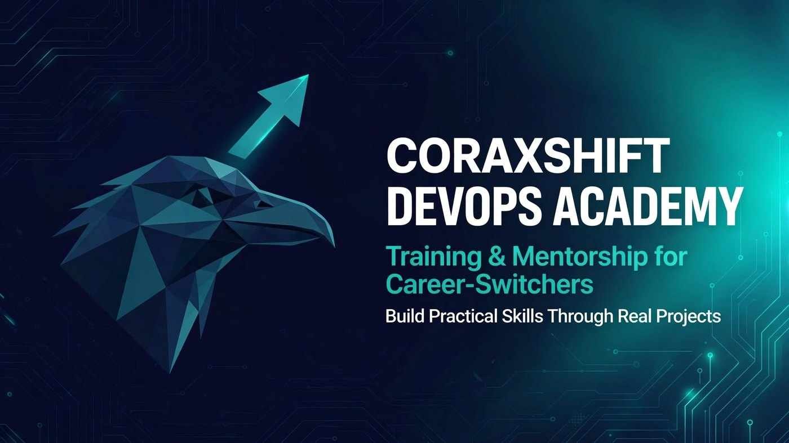

<div align="center">



# AWS for Beginners

[](GETTING-STARTED.md)
[](course/00-overview.md)
[](#️-how-long-it-takes)
[](course/00-overview.md)

### ☁️ Rent real computers, networks and databases, and never get a surprise bill.

**Coraxshift DevOps Academy** · *Learn. Build. Deploy. Grow.*

[🚀 Get started](GETTING-STARTED.md) · [📖 Course overview](course/00-overview.md) · [🆘 Troubleshooting](course/troubleshooting.md) · [🌐 Website](https://coraxshift-academy.github.io/)

</div>

---

> [!WARNING]
> **DRAFT, not yet tested in a live AWS account.** The steps were written from AWS's documented behaviour and the shell commands were syntax-checked, but nobody has yet run every click in a real account. AWS also moves buttons around. Your instructor will confirm this notice is gone before you start.

> **The code for this course is in [`files/`](files). Every AWS command is a runnable script, and LocalStack lets you practise them for free before touching a real account.**
> Start with [`files/README.md`](files/README.md): prerequisites, learning objectives, both the local and the cloud way to run it, expected output for every step, and cleanup.


## 🎯 What you will be able to do

| | |
|---|---|
| 🔐 **Protect** | Open an AWS account safely: no daily use of the root login, MFA on, budget alerts before anything else |
| 🖥️ **Launch** | Start, reach, stop and delete a server (EC2) |
| 🌐 **Network** | Build your own private network (VPC) with public and private subnets |
| 🗄️ **Store** | Keep files in S3 safely and keep them private |
| 🧮 **Database** | Run a managed database (RDS) that only your server can reach |
| ⚖️ **Scale** | Put a load balancer in front of servers that replace themselves (Auto Scaling) |
| 🧭 **Name** | Give things friendly names with Route 53 |
| 👀 **Watch** | Read CloudWatch graphs and get an alarm email |
| 🧹 **Clean up** | Prove nothing is left running, so nothing is charged |
| 💼 **Show off** | Put the whole journey and a cost report in your portfolio |

> [!IMPORTANT]
> **This is the first course where a mistake can cost real money.** Every lab starts with a 💰 box that says what it costs and how to tear it down. Do the teardown **in the same sitting**, every time.

> [!NOTE]
> You need an AWS account and a payment card (AWS asks for one even for the free allowance). You need **Linux**, **Bash** and **Git and GitHub for Beginners**. **Terraform** is recommended, because you will recognise the ideas.

## ⏱️ How long it takes

9 classes (about 2 to 3 hours each) + an assignment (3 hours) + a role play, a quiz and a recap = **about 28 hours in total**. Go at your own pace, but never leave a lab running overnight.

## 🗺️ Course map

| Step | What you do | Time |
|:--|:--|--:|
| 📘 Overview | [Welcome, goals, costs, how the course works](course/00-overview.md) | 15 min |
| 🔐 Class 1 | [A safe account and billing alarms](course/class-1-safe-account-and-billing.md) | 2.5 h |
| 🖥️ Class 2 | [Your first server (EC2)](course/class-2-your-first-server-ec2.md) | 2.5 h |
| 🌐 Class 3 | [Your own network (VPC and subnets)](course/class-3-your-own-network-vpc.md) | 2.5 h |
| 🗄️ Class 4 | [Storage (S3)](course/class-4-storage-s3.md) | 2 h |
| 🧮 Class 5 | [A database (RDS)](course/class-5-database-rds.md) | 2.5 h |
| ⚖️ Class 6 | [Load balancer and Auto Scaling](course/class-6-load-balancer-and-autoscaling.md) | 3 h |
| 🧭 Class 7 | [Names (Route 53)](course/class-7-names-route-53.md) | 2 h |
| 👀 Class 8 | [Watching (CloudWatch)](course/class-8-watching-cloudwatch.md) | 2 h |
| 🧹 Class 9 | [Cost control and the final clean-up](course/class-9-cost-control-and-cleanup.md) | 2 h |
| 🧩 Assignment | [Launch the shop site, then remove it](course/assignment-launch-the-shop-site.md) | 3 h |
| 🎭 Role play | [Explain the cloud to a shop owner](course/role-play-explain-the-cloud.md) | 15 min |
| 📝 Quiz | [12 questions, 90% earns the badge](course/quiz.md) | 20 min |
| 🏁 Finish | [Recap and what's next](course/recap-and-whats-next.md) | 10 min |
| 🆘 Stuck? | [Troubleshooting](course/troubleshooting.md) | any time |

## 🛡️ Safety rules

- Never use the **root** login for daily work. Never share it.
- Never put access keys, passwords or account numbers in a file, a commit or a screenshot.
- Tag everything you create with `Project = coraxshift-lab` so you can find it again.
- Work in **one region** (`us-east-1`, N. Virginia) so nothing hides somewhere else.
- **Tear down at the end of every class** and run the check script in `scripts/`.
- A budget alert *tells* you about spending. It does **not** stop it. You stop it.

## 📁 What is in this repository

```text
README.md             you are here
GETTING-STARTED.md    make your account, secure it, open CloudShell
assets/               banner and logo
course/               classes, assignment, role play, quiz, troubleshooting
scripts/              aws-cleanup-check.sh (read-only: lists what is still running)
```

<div align="center">


**Coraxshift DevOps Academy** · Learn. Build. Deploy. Grow.

Course material © 2026 Coraxshift DevOps Academy. For enrolled students only.

</div>
